# Численные методы: дифференцирование и решение СЛАУ


## Запуск

```bash
pip install numpy matplotlib
python task1_numdiff.py
python task2_slae.py
```

## Содержание

- [Лабораторная 1. Численное дифференцирование](#часть-1-численное-дифференцирование)
- [Лабораторная 2. Решение СЛАУ](#часть-2-решение-слау)

---


## Часть 1. Численное дифференцирование

### Постановка задачи

Построить графики абсолютной погрешности пяти формул численного дифференцирования в зависимости от шага

```
h_n = 2 / 2^n,  n = 1, …, 21
```

для функций:

- `sin(x²)`
- `cos(sin x)`
- `exp(sin(cos x))`
- `ln(x + 3)`
- `(x + 3)^0.5`

Масштаб по обеим осям — логарифмический, для каждой функции — отдельный рисунок. Точное значение производной вычисляется аналитически. Точка дифференцирования: `x₀ = 1`.

### Используемые формулы

| № | Формула | Порядок |
|---|---------|---------|
| 1 | `(f(x+h) − f(x)) / h` | `O(h)` |
| 2 | `(f(x) − f(x−h)) / h` | `O(h)` |
| 3 | `(f(x+h) − f(x−h)) / 2h` | `O(h²)` |
| 4 | `(4/3)·(f(x+h) − f(x−h))/2h − (1/3)·(f(x+2h) − f(x−2h))/4h` | `O(h⁴)` |
| 5 | `(3/2)·(f(x+h) − f(x−h))/2h − (3/5)·(f(x+2h) − f(x−2h))/4h + (1/10)·(f(x+3h) − f(x−3h))/6h` | `O(h⁶)` |

### Аналитические производные

- `(sin x²)′ = 2x·cos(x²)`
- `(cos(sin x))′ = −sin(sin x)·cos x`
- `(exp(sin(cos x)))′ = −exp(sin(cos x))·cos(cos x)·sin x`
- `(ln(x + 3))′ = 1/(x + 3)`
- `((x + 3)^0.5)′ = 0.5/√(x + 3)`

### Результаты

**Таблица 1.** Минимальная погрешность каждой формулы, шаг, на котором она достигается, и экспериментальный порядок точности.

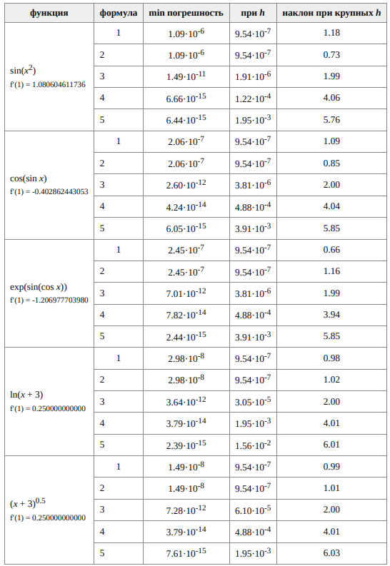

**Рис. 1.** Абсолютная погрешность производной `sin(x²)` в точке `x₀ = 1`.

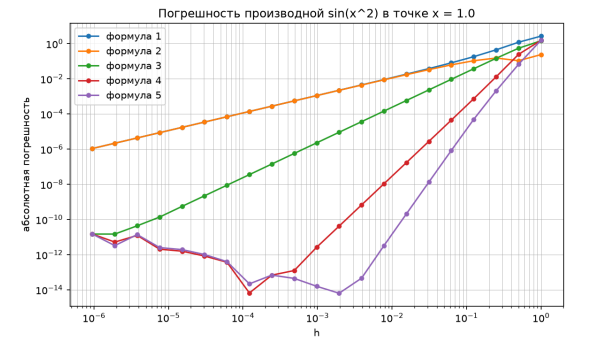

**Рис. 2.** Абсолютная погрешность производной `cos(sin x)` в точке `x₀ = 1`.

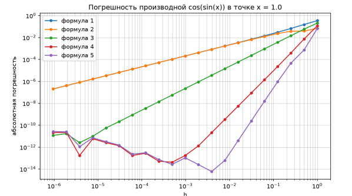

**Рис. 3.** Абсолютная погрешность производной `exp(sin(cos x))` в точке `x₀ = 1`.

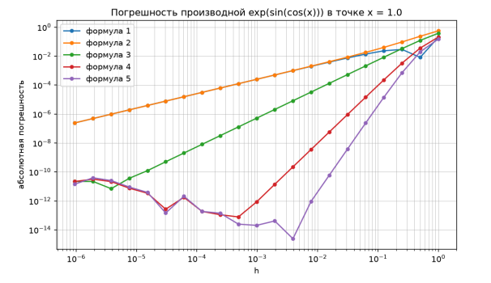

**Рис. 4.** Абсолютная погрешность производной `ln(x + 3)` в точке `x₀ = 1`.

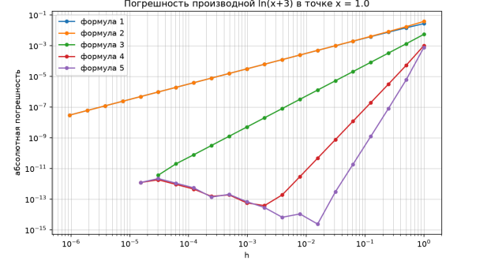

**Рис. 5.** Абсолютная погрешность производной `(x + 3)^0.5` в точке `x₀ = 1`.

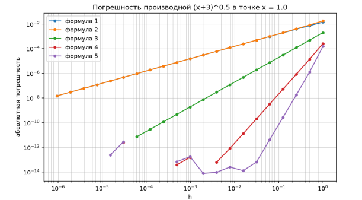

### Выводы по части 1

- При больших `h` погрешность определяется ошибкой аппроксимации `C·h^p`; на логарифмических графиках это прямые с наклоном `p`. Измеренные наклоны ≈ 1, 1, 2, 4, 6 совпадают с теоретическими порядками формул.
- При уменьшении `h` растёт ошибка округления: значения функции вычисляются с относительной погрешностью `ε ≈ 1.1·10⁻¹⁶`, и в разности, делённой на `h`, она даёт вклад порядка `ε/h`. Поэтому у каждой формулы есть оптимальный шаг `h_опт ~ ε^(1/(p+1))`.
- Оценки `h_опт`: ~`10⁻⁸` для формул 1–2 (меньше минимального шага задачи `h₂₁ ≈ 9.5·10⁻⁷`, поэтому их погрешность монотонно убывает до конца диапазона); ~`5·10⁻⁶` для формулы 3; ~`7·10⁻⁴` для формулы 4; ~`5·10⁻³` для формулы 5. Наблюдаемые минимумы лежат именно в этих областях.
- Формулы высокого порядка достигают точности ~`10⁻¹⁴…10⁻¹⁵`, близкой к машинной, уже при сравнительно крупном шаге.
- При `h → 0` графики формул 3–5 сливаются: погрешность определяется только округлением и растёт примерно как `ε/h`.
- Формулы 1 и 2 (односторонние разности) имеют одинаковый порядок, но разные знаки главного члена погрешности `±h·f″/2`, поэтому при крупных `h` их графики немного расходятся.

---

## Часть 2. Решение СЛАУ

### Постановка задачи

Решить СЛАУ `Ax = f` из задачи II.10.5 (Аристова, Лобанов, Завьялова, «Практикум по вычислительной математике») методами:

- Гаусса с выбором главного элемента;
- LU-разложения;
- Якоби;
- Зейделя;
- верхней релаксации (SOR);
- градиентного спуска;
- минимальных невязок;
- сопряжённых градиентов;
- BiCGStab (стабилизированный метод бисопряжённых градиентов).

Найти `λ_min`, `λ_max`, число обусловленности `μ = ‖A‖·‖A⁻¹‖`, напечатать невязки, указать критерий останова итераций. Для итерационных методов построить графики убывания невязки.

### Выбранный вариант — к)

```
n = 10
a_ii = 1
a_ij = 1/(i + j),  i ≠ j
f_i = 1/i,         i, j = 1, …, n
```

Матрица симметрична и положительно определена (`A = Aᵀ > 0`), к ней применимы все методы списка, включая LU и сопряжённые градиенты. При этом матрица не имеет диагонального преобладания: метод Якоби на ней расходится, а Зейдель сходится, что хорошо иллюстрирует условия сходимости.

### Критерий останова

```
‖f − Ax‖₂ / ‖f‖₂ < ε = 10⁻¹²
```

Итерации также прекращаются после 10000 шагов или если невязка превысила `10¹⁰` (метод расходится).

### Вывод программы

```
lambda_min = 0.65796,  lambda_max = 2.04836
mu_1 = 5.6336   mu_2 = 3.1132   mu_inf = 5.6336
rho_Якоби   = 1.0484
rho_Зейделя = 0.2224
Критерий останова: ||f - Ax|| / ||f|| < 1e-12

Гаусс                невязка 4.17e-17
LU                   невязка 8.12e-17
Якоби                невязка 1.03e+10,  итераций 491
Зейдель              невязка 2.77e-13,  итераций 18
BP, ω = 0.90         невязка 2.75e-13,  итераций 16
Градиентный спуск    невязка 8.39e-13,  итераций 36
Мин. невязки         невязка 5.24e-13,  итераций 33
Сопр. градиенты      невязка 3.59e-13,  итераций 9
BiCGStab             невязка 6.79e-14,  итераций 6
```

**Таблица 2.** Сводка по методам решения СЛАУ для варианта к).

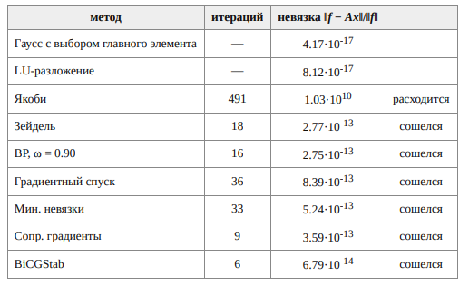

**Рис. 6.** Убывание относительной невязки итерационных методов.

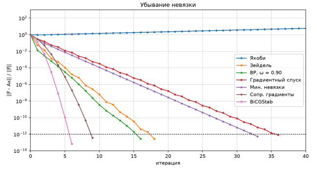

**Рис. 7.** Невязка каждого итерационного метода на всём числе итераций.

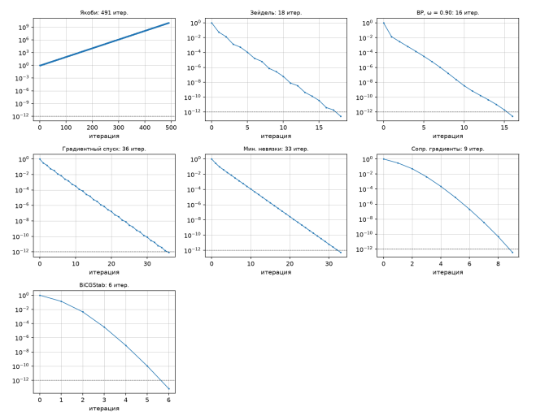

**Рис. 8.** Число итераций метода верхней релаксации до невязки `10⁻¹²` в зависимости от `ω`.

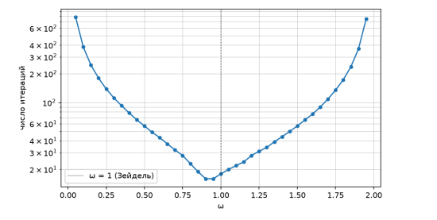

### Анализ сходимости

- Прямые методы (Гаусс, LU) дают невязку ~`10⁻¹⁷`, что соответствует `ε·μ`. LU-разложение применимо, так как `A = Aᵀ > 0`.
- `λ_min ≈ 0.658`, `λ_max ≈ 2.048`; все собственные числа положительны, матрица симметрична — `A = Aᵀ > 0`.
- `μ₂ = λ_max/λ_min ≈ 3.11`, `μ₁ = μ_∞ ≈ 5.63`: система хорошо обусловлена, прямые методы дают решение с погрешностью на уровне машинной точности.
- Диагонального преобладания нет: в первой строке `Σ_{j≠1}|a₁ⱼ| = 1/3 + … + 1/11 ≈ 1.02 > a₁₁ = 1`. Поэтому `ρ_Якоби ≈ 1.048 > 1` — метод Якоби расходится, а `ρ_Зейдель ≈ 0.222 < 1` — метод Зейделя сходится.
- BiCGStab сходится за минимальное число итераций (6), сопряжённые градиенты — за 9. SOR с оптимальным `ω ≈ 0.9` сходится за 16 итераций.
- Плохая обусловленность `AᵀA` (число обусловленности возводится в квадрат) объясняет медленную сходимость градиентного спуска и метода минимальных невязок на ряде вариантов; сопряжённые градиенты и BiCGStab сходятся на всех вариантах, метод Якоби расходится только на варианте к).

**Таблица 3.** Результаты по всем вариантам задачи.

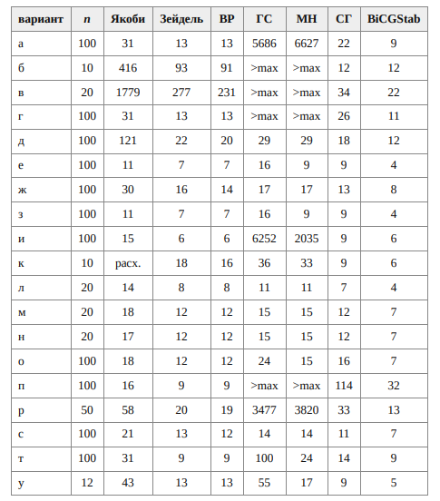
